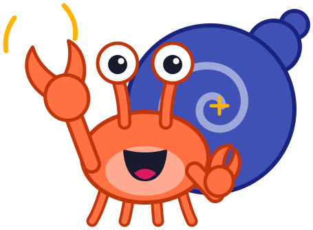
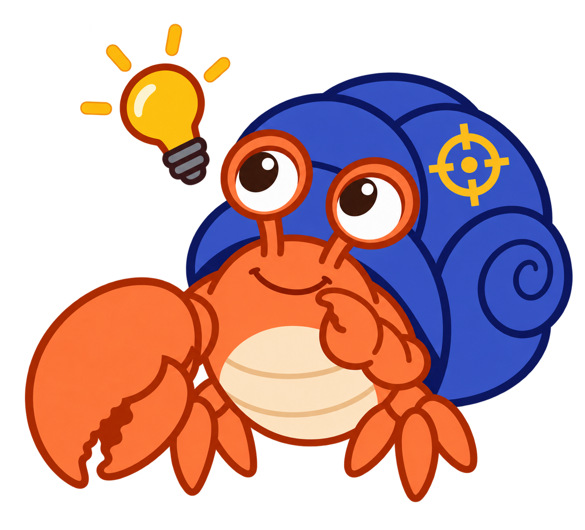
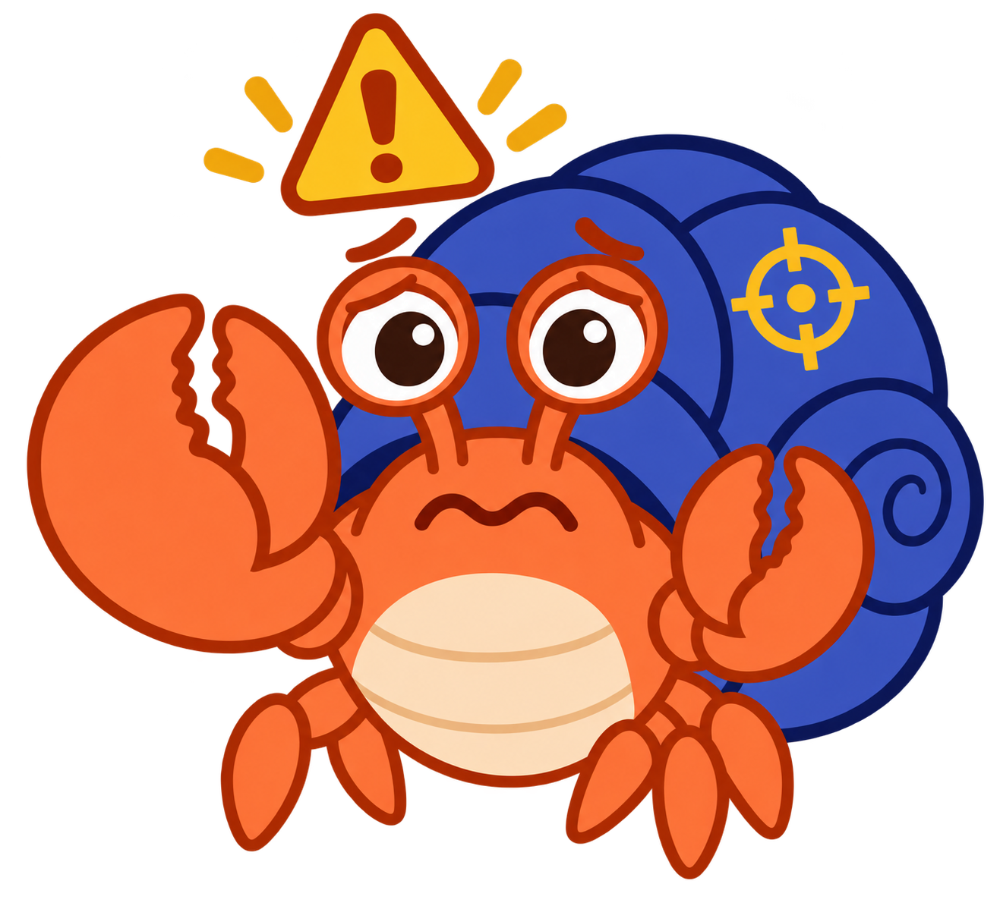
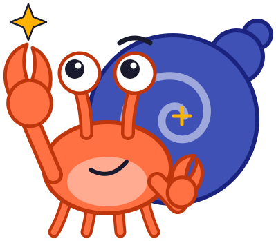

# Maintenance and Open Source Sharing

## Summary

This chapter looks past the first install. It covers technical debt, operating system compatibility, toolchain changes, and patch releases, then the open source path: licenses including MIT and Creative Commons, public repositories, forks, pull requests, community contribution, and documentation for others. After this chapter, you will be able to assess the long-term cost of maintaining a personal tool and prepare one for sharing.

## Concepts Covered

This chapter covers the following 15 concepts from the learning graph:

| Concept | Concept Impact Score |
|---------|-----------------------|
| Technical Debt | 1 |
| Operating System Compatibility | 1 |
| Toolchain Changes | 1 |
| Patch Release | 1 |
| Open Source Software | 13 |
| Open Source License | 5 |
| Permissive License | 4 |
| MIT License | 3 |
| Creative Commons License | 1 |
| Public Repository | 7 |
| Forking | 4 |
| Pull Request | 3 |
| Community Contribution | 2 |
| Long-Term Stewardship | 1 |
| Documentation For Others | 3 |

## Prerequisites

This chapter builds on concepts from:

- [Chapter 3: Licenses, Subscriptions, and Vendor Incentives](../03-licenses-subscriptions/index.md)
- [Chapter 4: Total Cost of Ownership](../04-total-cost-of-ownership/index.md)
- [Chapter 5: Generative AI and Coding Agents](../05-generative-ai-coding-agents/index.md)
- [Chapter 6: Build or Buy and the Rise of Personal Software](../06-build-or-buy/index.md)
- [Chapter 8: Software Design and Platform Constraints](../08-software-design-platform/index.md)
- [Chapter 9: Generating, Building, and Installing the Code](../09-generating-building-installing/index.md)
- [Chapter 13: Bugs, Evidence, and Verification Plans](../13-bugs-evidence-verification/index.md)

---

!!! mascot-welcome "The Shell You Carry Next Year"
    { class="mascot-admonition-img" }
    Building a tool is a weekend. Keeping it working is a decade, and a tool you share can have help carrying it. By the end of this chapter you will be able to estimate that decade honestly and publish your tool so others can pick it up. Grab only what you need!

The ScreenGrab story so far has an end that looks like a beginning: the app is installed and working. Chapter 4 taught you that the purchase price is only part of the cost of ownership, and the same is true of a tool you generate. The $6 build is the cheap part. This chapter covers the cost that arrives later, and the option that spreads it across other people: open source.

## Technical Debt

**Technical debt** is the future cost created by choosing a quick or incomplete solution now. Like financial debt it accrues interest: every later change takes longer because of the shortcut. In a personal tool, typical debts are undocumented workarounds, code that only the original agent session understood, and dependencies that stop being updated.

ScreenGrab keeps its debt low on purpose. It has no third-party dependencies, so there are no outside libraries to fall behind. The pure logic is separated from the window code and covered by tests. Screen capture is isolated behind one type, so a change in Apple's capture technology touches one file. These choices cost a little at design time and save more in maintenance.

!!! mascot-thinking "Debt Has Interest"
    { class="mascot-admonition-img" }
    Think of a shortcut as a loan. The code ships today, and every later change pays a little interest. A tool you will keep for years should borrow less than a throwaway you will delete on Friday.

## Operating System Compatibility

**Operating system compatibility** is the ability of the software to keep working as the operating system changes. A tool that depends on system behavior is at the mercy of each new release. The ScreenGrab specification names two examples.

First, macOS ties the Screen Recording permission to the app's code signature. An app signed ad hoc gets a new identity whenever its code changes, so the permission must be granted again after such a rebuild. The scripts accept a stable signing identity to avoid this. Second, since macOS 15 the system periodically asks the user to re-confirm Screen Recording access for apps that capture the screen. That is outside the app's control, so the README documents it.

## Toolchain Changes

**Toolchain changes** are updates to the compilers, build tools, and test frameworks that turn your source code into a running app. A toolchain change can break a tool that never changed. ScreenGrab shows this in miniature: it builds with the Swift tools that come with Command Line Tools, and the design document notes that, depending on the Swift version, the build may not find the testing framework, its macro plugin, or a run-time library. The test script passes all three locations, which is a fix for exactly this kind of drift. Managing the risk takes three habits: write down the tool versions you built with, rebuild occasionally rather than only when something breaks, and keep the build in a script rather than in your memory.

## Patch Releases

A **patch release** is a small new version that fixes a defect without adding features. Version numbers often follow the pattern major, minor, patch. A fix for a bug moves the last number, for example from 1.0.0 to 1.0.1 (a hypothetical example). A patch release tells users that updating is low risk. For a personal tool, a patch release is also a record that lets you tell which build is installed on which computer.

#### Worked example: a year of maintenance

The estimate below is illustrative. It uses invented hours, not measurements, to show how to think about the cost. Suppose one macOS update a year forces a compatibility fix, and one toolchain update a year forces a build fix. The table lists the hours and the cost if an AI session does the work at the ScreenGrab session rate of about $14 per session.

| Task per year | Illustrative hours of your time | Illustrative AI cost |
|---|---|---|
| Read release notes, test the app on the new macOS | 1 | $0 |
| Compatibility fix with an agent | 1 | $14 |
| Toolchain fix with an agent | 1 | $14 |
| Rebuild, reinstall on three computers, re-grant permission | 1 | $0 |
| **Total** | **4 hours** | **$28** |

At a value of $50 an hour for your time, which you should replace with your own, four hours is $200. Added to $28, that is about $228 a year, more than the $90 a year in subscription fees that the tool replaces. The illustration is deliberately not flattering: ownership cost is mostly your time. It also shows why sharing the work matters, which the rest of the chapter explains.

## Open Source Software

**Open source software** is software whose source code is available to everyone and whose license gives everyone the right to use, study, change, and share it. The Open Source Initiative's definition adds that an open source license must allow free redistribution, must include the source code, must allow derived works, and must not discriminate against people or fields of use. Open source does not mean free of support or free of effort, only free of permission barriers. Two things must both be true: you can see the code, and the license says you may use it. Code on a public web page with no license is visible but not open source, because nobody is granted permission.

ScreenGrab is open source. The code is public, and the MIT License grants everyone the right to use, change, and share the app, including commercially. That is how a $0 option exists for anyone who wants the app without the fee or the build.

#### Worked example: what open source does to the cost table

Return to the $90 a year of fees. For a reader who simply installs the finished open source app, the money cost is $0 and the build time is the time to run the installer. For a reader who wants changes, the cost is the time to fork and edit. For the author, the cost of building was $14 in tokens, and sharing adds the time to prepare and document the project. Open source does not remove the cost of the work. It lets many people share one copy of that cost.

## Open Source Licenses

An **open source license** is the legal document that gives others permission to use, change, and share your code, and sets any conditions. Without one, the law's default is that nobody except the author may copy or change the work, even if it is posted publicly. The license is what makes sharing real. Most licenses have the same three parts: a *grant* that says what you may do, *conditions* that say what you must do in return, and a *disclaimer* that says the software comes without warranty. Licenses also interact. If your tool includes a library under a copyleft license, that license can apply to your tool as well, which is another reason ScreenGrab's lack of dependencies is convenient.

Licenses fall into two broad families, defined next, and a few terms help read them. *Distribute* means to give copies to others. A *derivative work* is a new work built from the original, such as a changed copy.

!!! mascot-warning "No License Means No Permission"
    { class="mascot-admonition-img" }
    A public repository without a license file is not open source, because others have no legal right to reuse your code. Before you announce your tool, add a LICENSE file to the top folder, and check that the copyright line has your name and year.

## Permissive Licenses

A **permissive license** places very few conditions on reuse. Others may use, change, and even sell your code, usually as long as they keep your copyright notice. The other family is the copyleft license, such as the GNU General Public License, which adds a condition: if someone distributes a changed version, they must release it under the same license. Common permissive licenses are MIT, the BSD licenses, and Apache 2.0, which also grants a patent license. Permissive licenses suit tools you want used widely with no strings. Copyleft licenses suit projects whose authors want improvements to stay open.

#### Worked example: two ways to license the same tool

Suppose a company wants to put ScreenGrab into a commercial product. Under a permissive license, it may do so if it keeps the copyright and license notice. Under a copyleft license, it would have to publish its changed version's source under the same license. Neither choice is better in general. The author's goal decides: ScreenGrab is meant to give people a free tool with no strings, so a permissive license fits.

## The MIT License

The **MIT License** is a short, popular permissive license. It grants everyone permission to use, copy, modify, merge, publish, distribute, sublicense, and sell copies of the software. It has two conditions: include the copyright notice and the permission notice in all copies, and accept that the software comes with no warranty. ScreenGrab's LICENSE file reads "MIT License, Copyright (c) 2026 Dan McCreary". The whole license is about twenty lines, which is part of why people choose it. Its warranty disclaimer matters to a personal-tool author: if your tool misbehaves on someone else's machine, the license says you are not liable for it.

## Creative Commons Licenses

A **Creative Commons license** is one of a family of licenses designed for creative works such as text, images, and music, not for software code. Each license is a combination of conditions: BY means credit the author, NC means non-commercial use only, SA means share adaptations under the same license. This book's text is licensed CC BY-NC-SA 4.0, while its code is MIT.

Note that a license with the NC condition restricts commercial use, so it is generally not considered an open source license, although it still allows free sharing and adapting. Use Creative Commons for writing and images, and an open source license for code.

!!! mascot-tip "One Folder, Two Licenses"
    { class="mascot-admonition-img" }
    If your project has both code and prose, say so in plain words. Put the code license in a LICENSE file and write one sentence in the README, such as "The text is CC BY-NC-SA 4.0". Readers will not have to guess.

Try matching licenses to scenarios before moving on.

#### Diagram: Open Source License Matcher

<iframe src="../../sims/open-source-license-matcher/main.html" height="581px" width="100%" scrolling="no"></iframe>

[Run the Open Source License Matcher MicroSim Fullscreen](../../sims/open-source-license-matcher/main.html){ .md-button .md-button--primary }

Open Source License Matcher

Type: microsim
**sim-id:** open-source-license-matcher 
**Library:** p5.js 
**Status:** Specified 
**Template:** https://github.com/dmccreary/search-microsims/tree/main/docs/sims/cc-license-chooser 
**Bloom Level:** Apply 
**Bloom Verb:** apply 
**Learning Objective:** The learner will apply the conditions of five license choices to choose the license that fits each of eight scenarios, with at least 7 of 8 correct on the first attempt.

**Prerequisites:** open source license, permissive license, copyleft, MIT License, Creative Commons license, the BY, NC and SA conditions (all defined in the chapter above this block).

**Evidence of Mastery:** The learner assigns one of five license choices to each of eight scenarios. An assignment is correct when it matches the Correct choice in Content. Mastery is 7 of 8 correct on the first attempt per scenario. Reading the reasons is exploration, not evidence.

**Misconceptions:** (1) Any Creative Commons license is also an open source license. (2) A public repository with no license can be reused freely. (3) Copyleft and permissive licenses place the same conditions on reuse.

**Instructional Rationale:** Applying the conditions to concrete scenarios shows that license choice depends on what the author wants others to be able to do. Eight scenarios cover each choice at least once and force the learner to apply the conditions rather than recall names.

**Content:**

The five choices: MIT License, Copyleft license (such as the GNU General Public License), CC BY 4.0, CC BY-NC-SA 4.0, No license (all rights reserved).

| # | Scenario | Correct choice | Why (shown as feedback) |
|---|---|---|---|
| 1 | Source code of a small utility. Anyone may use it for any purpose, including commercially. They only need to keep your credit. | MIT License | MIT is permissive and asks only for the copyright notice. |
| 2 | Source code where anyone who distributes an improved version must also release its source. | Copyleft license (such as the GNU General Public License) | Copyleft requires changed versions to carry the same license. |
| 3 | Chapters of a book that may be shared and adapted with credit, not used commercially, with adaptations under the same terms. | CC BY-NC-SA 4.0 | BY gives credit, NC bars commercial use, SA keeps adaptations under the same terms. |
| 4 | A collection of diagrams that anyone, including companies, may reuse with credit. | CC BY 4.0 | BY alone requires only credit and allows commercial reuse. |
| 5 | A personal script on your own laptop that you never share. | No license (all rights reserved) | Nobody else needs permission, so no license is needed. |
| 6 | Short code samples in a textbook that readers may paste into their own commercial apps. | MIT License | Code samples suit a permissive code license. |
| 7 | Photos on a website that may be reused commercially if the photographer is credited. | CC BY 4.0 | Photos are creative works, and BY allows commercial reuse with credit. |
| 8 | Lesson plans that teachers may remix, provided remixes carry the same terms and are not resold. | CC BY-NC-SA 4.0 | NC bars resale and SA keeps remixes under the same terms. |

**Provenance:** The license conditions are from the chapter sections "Permissive Licenses", "The MIT License" and "Creative Commons Licenses". Scenarios are written by the chapter author.

**Rules:** Five answer choices per scenario. A scenario is correct when the chosen license equals the Correct choice. The score counts first answers only. The order is fixed as listed. The sim states that it is an educational exercise and not legal advice.

**Learner Activity:**

1. The learner reads scenario 1 and chooses one of five licenses.
2. The sim shows correct or incorrect and the Why text. An answered scenario cannot be changed.
3. The learner moves through scenarios 2 to 8 in order.
4. After scenario 8, the sim shows the score and a table of the eight scenarios grouped by license.
5. The learner should notice that the Creative Commons choices are used for text and images, and the other choices for code.

**Feedback:** Eight scenarios, fixed order, one attempt each. Correct: "Correct: [license]." plus the Why text. Incorrect: "Not quite: [Why text]." The score "Correct on first attempt: n of 8" is shown at the end, with "Mastery" when n >= 7.

**Starting State:** Scenario 1 is shown with five unselected license choices. The question on screen is "Which license fits what this author wants?"

**Chapter Anchors:** The chapter states ScreenGrab's code is under the MIT License, this book's text is CC BY-NC-SA 4.0, and a license with the NC condition is generally not considered open source.

## Public Repositories

A **public repository** is a project folder, with its full change history, hosted where anyone can see it. ScreenGrab lives at `github.com/dmccreary/macos-screen-grab`. Making it public is what turns a license into something people can use.

#### Worked example: a pre-publication checklist

Before making a repository public, check these items one at a time.

1. A `LICENSE` file is in the top folder.
2. A README explains what the tool does and how to install it.
3. No passwords, keys, tokens, or personal data are in the files or in the history.
4. Paths on your own computer, such as your home folder name, are removed or made generic.
5. The build and the tests run on a clean machine from the instructions alone.

Item 3 is the dangerous one. A secret deleted in a later change is still in the history that anyone can read.

!!! mascot-warning "History Remembers Secrets"
    { class="mascot-admonition-img" }
    Removing a password from a file does not remove it from earlier versions, and a public repository exposes all of them. Search the files and the history before you publish, and if a key was ever committed, treat it as leaked and replace it.

## Forking

**Forking** is making your own copy of someone else's repository under your own account. The copy keeps its link to the original, so you can bring in later updates. A fork is the normal way to change a project you do not own. Over time the original moves on, so a fork has to bring in the original's updates (often called syncing with upstream) or it drifts apart. With a permissive license, the fork keeps the original copyright notice and adds its own changes under its own name. You edit your copy freely, without asking permission and without affecting the original.

#### Worked example: a fork for a different shortcut

Suppose a reader prefers Control-Option-S for a grab and wants it as the default. They fork ScreenGrab, change the default in their copy, and build and install their fork. Their fork is now theirs to maintain. Because the license is MIT, they need no permission. If the change would help everyone, they can offer it back to the original, using a pull request.

## Pull Requests

A **pull request** is a proposal to merge changes from one branch or fork into another repository. It shows the differences, collects comments, and lets the owner accept or decline. Owners review pull requests because a change from a stranger, or from an AI agent, needs checking just as any code does. A good pull request is small, explains why, and includes the evidence from Chapter 13. Review matters most when the author is an AI agent, because the reviewer must check that the change does what it claims and nothing more. The owner may also decline, and a declined pull request is not an insult: the proposal may simply not fit the project's purpose.

The next diagram follows one contribution from discovery to merge, and asks where the code changes at each step.

#### Diagram: Fork and Pull Request Flow

<iframe src="../../sims/fork-and-pull-request-flow/main.html" height="584px" width="100%" scrolling="no"></iframe>

[Run the Fork and Pull Request Flow MicroSim Fullscreen](../../sims/fork-and-pull-request-flow/main.html){ .md-button .md-button--primary }

Fork and Pull Request Flow

Type: workflow
**sim-id:** fork-and-pull-request-flow 
**Library:** Mermaid 
**Status:** Specified 
**Bloom Level:** Understand 
**Bloom Verb:** classify 
**Learning Objective:** The learner will classify each of the six steps of a contribution by where code changes (the contributor's fork, the original repository, or nowhere), with at least 5 of 6 correct.

**Prerequisites:** public repository, forking, pull request, community contribution (all defined in the chapter above this block).

**Evidence of Mastery:** For each step, the learner picks one of three places before the answer is shown. A pick is correct when it matches the Answer column in Content. Mastery is 5 of 6 correct. Opening a step to read its description is exploration, not evidence.

**Misconceptions:** (1) Forking changes the original repository. (2) Opening a pull request changes the original code. (3) The contributor can merge their own change into someone else's project.

**Instructional Rationale:** Classifying where code changes at each step corrects the most common confusion, that a fork or a pull request alters the original. Committing an answer before the reveal makes the learner reason about ownership instead of reading it.

**Content:**

The diagram is a flowchart with six steps in order. Each step is clickable. Clicking opens an information box with the description and three choices: "Contributor's fork", "Original repository", "Nowhere (no code changes)".

| # | Step | Description | Answer | Reason |
|---|---|---|---|---|
| 1 | Find the public repository | A contributor reads the code and the LICENSE file of a public repository | Nowhere (no code changes) | Reading changes nothing. |
| 2 | Fork it | The contributor makes their own copy under their own account | Contributor's fork | The new copy is created in the contributor's account; the original is untouched. |
| 3 | Change and test the fork | The contributor edits the copy and runs the tests | Contributor's fork | All edits happen in the copy. |
| 4 | Open a pull request | The contributor proposes the changes to the owner | Nowhere (no code changes) | A pull request is a proposal; no code moves yet. |
| 5 | The owner reviews | The owner reads the differences, asks questions, and requests changes | Nowhere (no code changes) | Review is discussion; the original code is unchanged. |
| 6 | The owner merges | The owner accepts the proposal and brings the changes in | Original repository | Only the owner's decision changes the original. |

Edge labels: "copy" from step 2 to step 3, "propose" from step 3 to step 4, "feedback" from step 5 back to step 3, "accept" from step 5 to step 6.

**Provenance:** From the chapter sections "Public Repositories", "Forking" and "Pull Requests". Step descriptions are the chapter author's wording.

**Rules:** Six steps, each with one correct answer. The score is the number of correct picks. Mastery when score >= 5. The order of the three choices is the same for every step.

**Learner Activity:**

1. The learner clicks a step. An information box shows the description and three choices.
2. The learner picks one choice. The sim marks it correct or incorrect and shows the Reason.
3. The learner opens the remaining steps in any order until all six are answered.
4. The learner should notice that only the final step changes the original repository.

**Feedback:** Six steps, any order, one attempt each. Correct: "Correct" plus the Reason. Incorrect: "Not quite: [Answer]" plus the Reason. The score "Correct: n of 6" is shown after the last step.

**Starting State:** The flowchart is shown with no step answered. The question on screen is "At which step does the original project actually change?"

**Chapter Anchors:** The chapter states a fork is a copy under the contributor's own account, a pull request is a proposal, and the owner decides whether to merge.

## Community Contribution

A **community contribution** is any help given to a project by people other than its original author: a bug report, a fix, a doc improvement, a test on another machine. Contributions are not only code. Bug reports with the reproduction recipe from Chapter 13 are valuable, as are documentation fixes and translations. For a personal tool the most valuable contribution is often a test report from a machine the author does not own, such as the Intel half of ScreenGrab's universal build that nobody has run yet.

## Long-Term Stewardship

**Long-term stewardship** is the ongoing responsibility for keeping a shared project healthy: reviewing contributions, making patch releases, answering issues, and, when the time comes, handing it over or retiring it with a clear note. Sharing a tool creates this duty. Typical duties are to reply to issues within a stated time, tag patch releases, and keep the dependency list short. It is fine to say in the README that a project is a personal tool with no support promised. Being clear about it is part of being a good steward.

## Documentation for Others

**Documentation for others** is written material that lets a stranger install, use, and change your tool without asking you. You wrote the tool, so you do not need a README to use it, which is why it gets skipped. For ScreenGrab the set includes a README with install steps, a specification of what it does, and a design document that explains why. A reader should be able to go from zero to a working install by following the README alone.

!!! mascot-celebration "You Know the Long Game"
    { class="mascot-admonition-img" }
    You can now estimate the yearly cost of keeping a tool alive, choose between permissive, copyleft, and Creative Commons licensing, and prepare a repository for strangers. Chapter 15 puts every number in this book to work on a decision of your own.

[See Annotated References](./references.md)
