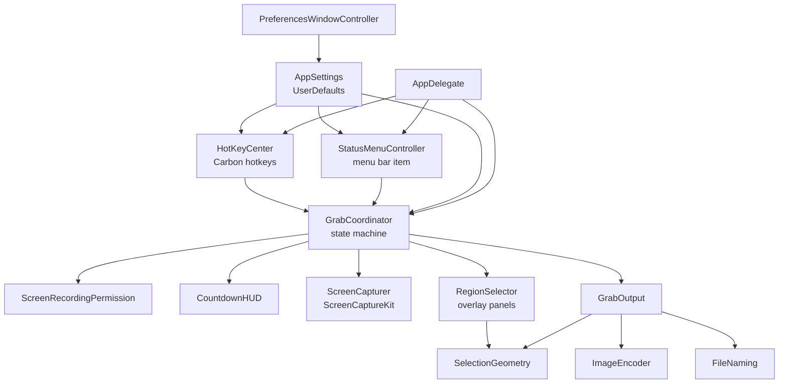
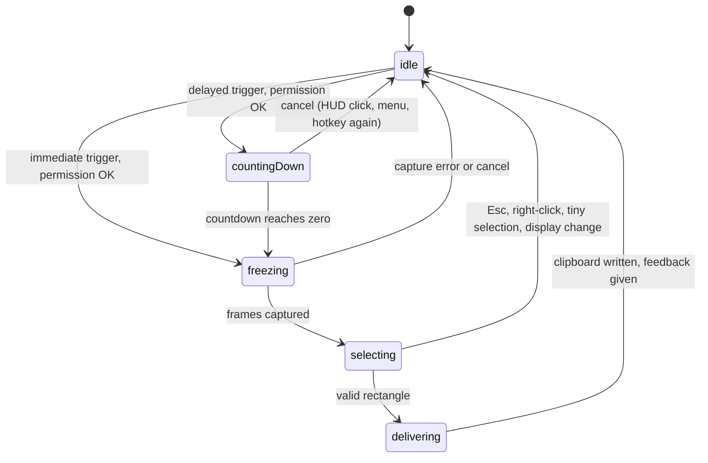
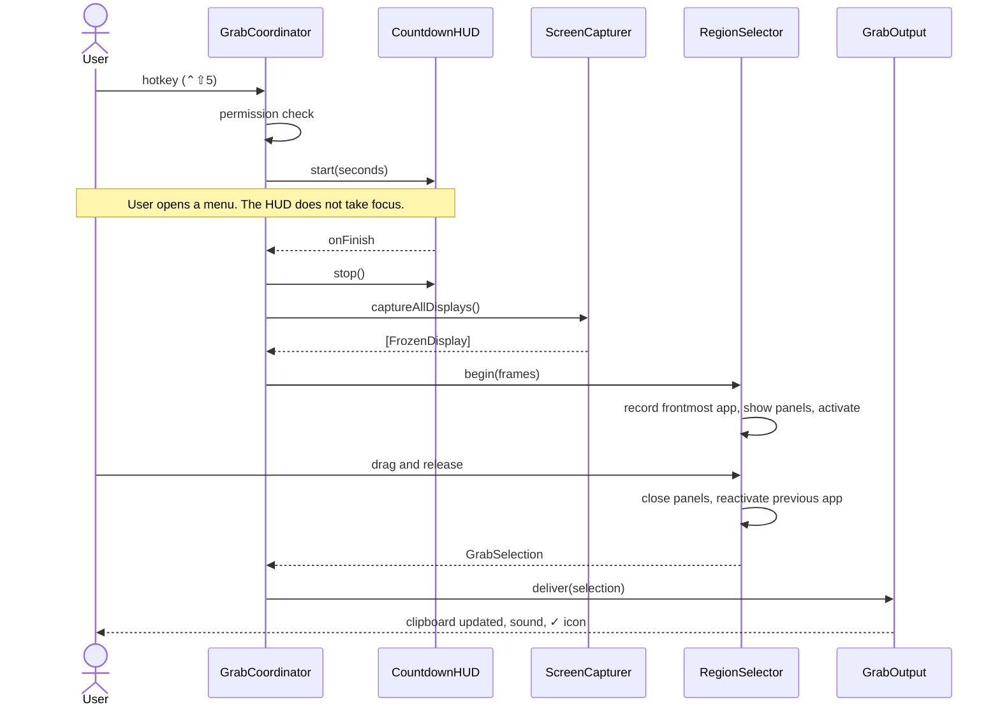
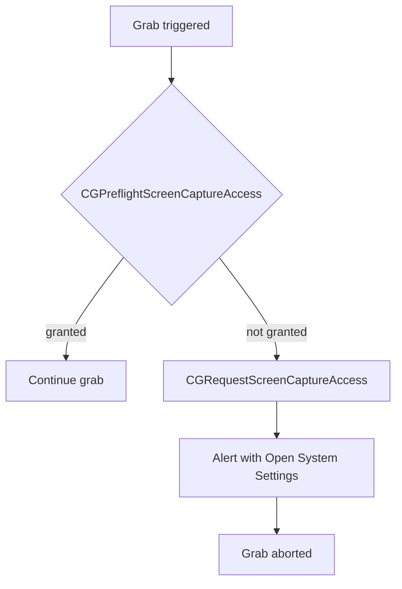

# ScreenGrab — Design

| | |
|---|---|
| **Status** | Draft v0.1 |
| **Date** | 2026-11-01 |
| **Implements** | [specification.md](specification.md) |

## 1. Overview

ScreenGrab is a menu bar agent written in Swift with AppKit and ScreenCaptureKit.
It has no third-party dependencies and builds with the Command Line Tools alone.

A grab has four stages:

1. **Trigger:** a global hotkey or a menu item.
2. **Freeze:** every display is captured to an in-memory still image. For a delayed
   grab, this happens when the countdown reaches zero.
3. **Select:** an overlay on each display shows that still image, dimmed. The user
   drags a rectangle.
4. **Output:** the rectangle is cropped from the still image, with no second
   capture, and placed on the clipboard.

Freezing first is the central design decision. It is explained in
[§2.1](#21-freeze-frame-selection).

## 2. Key design decisions

### 2.1 Freeze-frame selection

The selector has to show a crosshair and receive the Esc key. It also must not
change what ends up in the image. Two small test programs were run on the target
machine (macOS 26.6.2) to find out what a background app can do:

| Test | Result |
|---|---|
| Non-activating panel, `NSCursor.crosshair.set()` | Frontmost app unchanged and panel became key, but the **system cursor stayed an arrow** (hotspot 5,5) |
| Panel plus `NSApp.activate`, `NSCursor.crosshair.set()` | **System cursor became a crosshair** (hotspot 11,11) |
| After that, `orderOut` and `previousApp.activate()` | Focus returned to the previous app and the arrow cursor came back |

So a crosshair requires activating ScreenGrab. Activation has side effects: the
previously frontmost window greys out its title bar and traffic lights, and open
menus in other apps close. In a live-capture design those changes would appear in
the grab.

Capturing *before* activating removes the conflict:

| Concern | Live capture on mouse-up | Freeze-frame (chosen) |
|---|---|---|
| Crosshair and Esc | Needs activation, which changes the screen | Reliable; activation happens after the image is taken |
| Active window title bars | Greyed out in the grab | Preserved |
| Open menus and hover states | Can close before the capture | Preserved, which is the main purpose of a delayed grab |
| Own overlay in the image | Must be excluded | Impossible, because the image predates the overlay |
| What you see vs. what you get | Content can change between selecting and capturing | Identical pixels |
| Animations and video | Keep moving during selection | Appear paused (accepted) |
| Memory | Small | One full frame per display while selecting (about 17 MB per Retina display), freed afterwards |
| Latency | Overlay appears at once | Overlay waits for the capture (NFR-1 allows 300 ms) |

### 2.2 Other decisions

| Decision | Choice | Rationale |
|---|---|---|
| Capture API | `SCScreenshotManager.captureImage(contentFilter:configuration:)`, macOS 14+ | Current supported API. `CGWindowListCreateImage` is no longer available. |
| Global hotkeys | Carbon `RegisterEventHotKey` | Needs no Accessibility or Input Monitoring permission (FR-7.2). Registration returned `noErr` on the target machine in testing. Event taps would need those permissions. |
| Color | Always capture in **sRGB** | Tagged sRGB pastes predictably everywhere. Colors outside sRGB clip slightly, which is acceptable for screenshots. |
| Pasteboard formats | PNG **and** LZW-compressed TIFF | Some apps prefer one or the other. |
| Package structure | Library `ScreenGrabKit` plus a one-file executable `ScreenGrab` | Lets tests import everything, including views. |
| Tests | Swift Testing (`import Testing`), run through `scripts/test.sh` | The Command Line Tools ship `Testing.framework` but not XCTest. SwiftPM doesn't find the framework's macro plugin with these tools alone, so the script passes its path. |
| Swift language mode | Swift 5 (`swift-tools-version: 5.9`) | Avoids strict-concurrency friction with AppKit and Carbon callbacks. UI types are still annotated `@MainActor`. |
| UI construction | Programmatic AppKit | No Xcode means no storyboards or nibs. |
| Capture sound | System `Screen Capture.aif`, falling back to `Pop` | The file is present on the target machine, but the path isn't a public API, so the fallback is needed. |

## 3. Repository layout

```
macos-screen-grab/
├── .gitignore
├── docs/
│   ├── specification.md
│   └── design.md
├── dist/                         Build output, git-ignored
│   └── ScreenGrab.app
└── src/
    ├── README.md                 Installation, usage, and troubleshooting
    ├── install.sh                Tests, builds, and installs the app
    ├── Package.swift
    ├── Info.plist                Bundle metadata (LSUIElement, bundle ID)
    ├── scripts/
    │   ├── build-app.sh          Builds, bundles, and signs the app
    │   └── test.sh               Runs the unit tests
    ├── Sources/
    │   ├── ScreenGrab/
    │   │   └── main.swift        Application entry point
    │   └── ScreenGrabKit/
    │       ├── AppDelegate.swift
    │       ├── StatusMenuController.swift
    │       ├── GrabCoordinator.swift
    │       ├── ScreenCapturer.swift
    │       ├── ScreenRecordingPermission.swift
    │       ├── Alerts.swift
    │       ├── RegionSelector.swift
    │       ├── OverlayViews.swift
    │       ├── SelectionGeometry.swift
    │       ├── CountdownHUD.swift
    │       ├── GrabOutput.swift
    │       ├── ImageEncoder.swift
    │       ├── FileNaming.swift
    │       ├── HotKeyCombo.swift
    │       ├── HotKeyCenter.swift
    │       ├── AppSettings.swift
    │       ├── PreferencesWindowController.swift
    │       └── ShortcutRecorderButton.swift
    └── Tests/
        └── ScreenGrabKitTests/
```

## 4. Architecture



| Component | Responsibility |
|---|---|
| `AppDelegate` | Startup, single-instance check, wiring, display-change notification |
| `StatusMenuController` | Status item, menu contents, icon feedback |
| `GrabCoordinator` | Owns the grab state machine; the only component that sequences a grab |
| `ScreenCapturer` | Captures each display to a `FrozenDisplay`; the only ScreenCaptureKit user |
| `ScreenRecordingPermission` | Preflight, system prompt, explanatory alert |
| `Alerts` | Modal alerts from a menu bar app, returning focus to the previous app afterwards |
| `RegionSelector` | Creates one overlay panel per display, handles activation and focus handback |
| `OverlayViews` | Draws the still image, dimming, border, and label; handles mouse and keyboard |
| `SelectionGeometry` | Pure geometry functions; see [§6](#6-coordinate-systems-and-geometry) |
| `CountdownHUD` | Non-activating countdown panel with click-to-cancel |
| `GrabOutput` | Crops, encodes, writes the clipboard, optionally saves |
| `ImageEncoder` | CGImage to PNG and TIFF data with DPI metadata |
| `FileNaming` | Timestamped filenames and collision suffixes |
| `HotKeyCombo` | Value type for a shortcut: validation and display strings |
| `HotKeyCenter` | Registers and unregisters shortcuts with Carbon |
| `AppSettings` | Typed access to `UserDefaults`, clamping, change callback |
| `PreferencesWindowController`, `ShortcutRecorderButton` | Preferences UI |

### 4.1 Testing seams

`GrabCoordinator` reaches its collaborators through small protocols, so the state
machine can run in tests with no screen, no permission, and no windows:

```swift
protocol DisplayCapturing     { func captureAllDisplays() async throws -> [FrozenDisplay] }
protocol PermissionChecking   { func ensureGranted() -> Bool }
protocol CountdownPresenting  { func start(seconds: Int, onFinish: @escaping () -> Void, onCancel: @escaping () -> Void); func stop() }
protocol SelectionPresenting  { func begin(_ frames: [FrozenDisplay], onFinish: @escaping (GrabSelection?) -> Void); func cancel() }
protocol GrabOutputting       { func deliver(_ selection: GrabSelection) async -> GrabOutcome }
protocol GrabFeedback         { func grabSucceeded(); func grabFailed(_ failure: GrabFailure) }
```

## 5. Grab workflow

### 5.1 State machine



Trigger handling by state (FR-2.10, FR-3.4):

| State | Grab Region trigger | Delayed trigger | `cancel()` |
|---|---|---|---|
| `idle` | Starts | Starts | No effect |
| `countingDown` | Ignored | **Cancels** | Cancels |
| `freezing` | Ignored | Ignored | Cancels; late frames are discarded |
| `selecting` | Ignored | Ignored | Cancels |
| `delivering` | Ignored | Ignored | No effect; delivery is nearly complete |

### 5.2 Delayed grab sequence

The immediate grab is the same sequence without the first three steps.



## 6. Coordinate systems and geometry

Screen capture bugs usually come from mixing origins and units. Freeze-frame reduces
the problem to one conversion.

| Space | Origin | Unit | Used by |
|---|---|---|---|
| AppKit global | Bottom-left of primary display | Points | `NSScreen.frame`, panel placement |
| View local | **Top-left of the display** (views are flipped) | Points | All selection logic |
| Image | Top-left of the frozen image | Pixels | `CGImage.cropping(to:)` |

- AppKit global coordinates appear in one place: each panel's frame is set to
  `screen.frame`. AppKit handles the placement, and no global math is done by hand.
- The overlay view fills its display and has `isFlipped = true`, so a view point is
  already a top-left-origin, display-local position.
- Both view and image coordinates have a top-left origin, so **no Y flip is needed**.
  Only the scale differs:

```
scale     = frozenImage.pixelWidth / screen.frame.width
pixelRect = pointRect × scale, rounded to whole pixels, clamped to the image bounds
```

The scale comes from the actual image rather than `backingScaleFactor`, so a scaled
display mode can't cause a mismatch between what was highlighted and what is cropped.
Each `FrozenDisplay` carries its own scale, which handles mixed-DPI setups (FR-4.3).

Pure functions in `SelectionGeometry`, all unit-tested:

| Function | Purpose | Requirement |
|---|---|---|
| `selectionRect(from:to:within:)` | Normalizes a drag in any direction and clamps it to the display | FR-2.3, FR-4.1 |
| `pixelRect(forPointRect:scale:imagePixelSize:)` | Point-to-pixel conversion with rounding and clamping | FR-4.3, NFR-6 |
| `isAccidental(pixelRect:)` | True when either dimension is under 4 pixels | FR-2.6 |
| `labelOrigin(pointer:labelSize:bounds:)` | Places the label near the pointer, keeping it on screen | FR-4.4 |

## 7. Component details

### 7.1 ScreenCapturer

For each `NSScreen`, the `SCDisplay` is matched by `CGDirectDisplayID` (from the
screen's `NSScreenNumber`), then captured with:

| Setting | Value | Why |
|---|---|---|
| Filter | `SCContentFilter(display:excludingApplications:[self],exceptingWindows:[])` | Keeps ScreenGrab's Preferences window and the closing HUD out of the frame (FR-2.7) |
| `width`, `height` | Display points × `backingScaleFactor` | Native pixels (A2, NFR-6) |
| `captureResolution` | `.best` | No downsampling |
| `showsCursor` | `false` | A1 |
| `colorSpaceName` | sRGB | [§2.2](#22-other-decisions) |

`SCShareableContent` is fetched fresh for each grab, so display changes are always
reflected. Frames are captured concurrently.

Excluding the whole app also removes ScreenGrab's own menu bar icon from grabs of
the menu bar. This is a harmless side effect of FR-2.7.

When a grab starts from the menu rather than a hotkey, the coordinator waits about
100 ms first so the closing menu isn't in the frame.

### 7.2 RegionSelector and overlay views

**Panel:** one `NSPanel` per display, borderless and `.nonactivatingPanel`, with
`canBecomeKey = true`, `level = .screenSaver` (above the menu bar and Dock), and
`collectionBehavior = [.canJoinAllSpaces, .fullScreenAuxiliary, .stationary, .ignoresCycle]`.

**Start sequence:**

1. Record `NSWorkspace.shared.frontmostApplication`.
2. Order all panels front; the panel under the pointer becomes key.
3. Call `NSApp.activate(ignoringOtherApps: true)`. This is the call tested in
   [§2.1](#21-freeze-frame-selection). It is deprecated from macOS 14 but works; the
   newer `activate()` is cooperative and could be refused.
4. Register `.crosshair` as the cursor rect across each overlay, and set it again when
   the app's activation completes, because the pointer may not be moving at that moment.

**View hierarchy** (two layers, so a drag never repaints the image):

- `FrozenImageView` draws the still image once.
- `SelectionOverlayView` is on top and transparent. It draws the dimming (an even-odd
  fill with the selection as a hole), the border, and the size label, invalidating
  only the changed area. It receives all mouse and keyboard events.

**Input:**

| Event | Action |
|---|---|
| `acceptsFirstMouse` | Returns `true`, so the first click starts the drag |
| `mouseDown`, `mouseDragged` | Updates the selection through `selectionRect`. AppKit keeps sending drags to the window that got the mouse-down, which is what confines a selection to one display (FR-4.1) |
| `mouseUp` | Finishes, or cancels if `isAccidental` |
| `rightMouseDown`, Esc (`keyCode` 53) | Cancels |
| `mouseMoved` | Updates the position label before a drag starts |

**Teardown** (`finish()`, single-shot, on every path): order out all panels, release
frames, reactivate the previous app unless it is ScreenGrab itself (FR-2.12,
FR-4.6), and call the completion handler once.

### 7.3 CountdownHUD

A borderless, `.nonactivatingPanel` `NSPanel` at `.screenSaver` level. It can't become
key and is shown with `orderFrontRegardless()`, so it never takes focus (FR-3.3). It
sits near the top of the display containing the pointer.

- The timer runs in `.common` run loop mode so it keeps ticking while the status menu
  is open. Without this, the *Cancel Grab* item would freeze the countdown.
- The display is computed from a fixed deadline, `ceil(deadline − now)`, to avoid drift.
- `acceptsFirstMouse` plus `mouseDown` provide click-to-cancel.

### 7.4 GrabOutput and ImageEncoder

```
deliver(selection):
    pixelRect = SelectionGeometry.pixelRect(...)
    cropped   = frame.image.cropping(to: pixelRect)
    encoded   = ImageEncoder.encode(cropped, scale)   // off the main thread
    write clipboard                                   // on the main thread
    if settings.saveToFolder: save PNG
```

- **Encoding** uses `CGImageDestination` with `kCGImagePropertyDPIWidth` and
  `kCGImagePropertyDPIHeight` set to `72 × scale`. That metadata is what makes a 2×
  image paste at its on-screen size (FR-5.2).
- **Clipboard:** `clearContents()`, then `.png` and `.tiff` data. The pasteboard is an
  injected parameter, so tests use a private named pasteboard and never touch the
  user's real clipboard.
- **Saving** runs after the clipboard write. A save failure is reported but doesn't undo
  the copy (FR-5.6). The result is a `GrabOutcome` that names any failure.
- `FileNaming` uses a fixed POSIX-locale date formatter and an injected "exists" check.

### 7.5 Hotkeys

`HotKeyCombo` is `Codable` and stores a virtual key code and Carbon modifier mask. It
provides validation (FR-7.3), a display string such as `⌃⇧4`, and the menu key
equivalent. Key names come from a table of ANSI keys and function keys, so labels
assume a US layout.

`HotKeyCenter` installs one Carbon event handler and maps `EventHotKeyID` to an action.
Shortcuts are registered with `kEventHotKeyExclusive`, because without it a shortcut
another app owns may not be reported as a conflict. A failure such as
`eventHotKeyExistsErr` (-9878) feeds the warning in FR-7.5. Testing confirmed that a
second process trying to take a registered shortcut gets this error.

While a `ShortcutRecorderButton` is recording, all hotkeys are **suspended** so the
keys being recorded don't start a grab.

### 7.6 Settings and Preferences

`AppSettings` wraps `UserDefaults`, clamps delay values to 1–60, and fires an `onChange`
callback that re-registers hotkeys and refreshes the menu. Preferences apply immediately.

The window is an `NSGridView` laid out per spec §8.4. Accessory apps have no visible main
menu, so a hidden `NSApp.mainMenu` supplies ⌘W and the standard Edit commands; without it
those key equivalents wouldn't work in the custom delay field.

Opening the app while it's already running shows Preferences (FR-6.7). This gives a way
in if the menu bar icon is hidden behind the notch.

### 7.7 Screen Recording permission



The check runs before the countdown, so the user doesn't wait through a delay only to
see an error. If a capture later fails with `SCStreamError.userDeclined`, the same alert
is shown. Nothing is ever pasted from a failed capture (FR-8.4).

The settings pane URL is
`x-apple.systempreferences:com.apple.preference.security?Privacy_ScreenCapture`.

### 7.8 Status menu and feedback

`NSMenuDelegate.menuNeedsUpdate` rebuilds dynamic state: the delay in the title, the
checkmark in the Delay submenu, shortcut display, and *Cancel Grab* visibility.

On success, the icon switches from `camera.viewfinder` to `checkmark.circle` for one
second, using template images so it follows light and dark menu bars.

## 8. Concurrency model

- All UI types and `GrabCoordinator` are `@MainActor`.
- Carbon hotkey callbacks arrive on the main thread through the main run loop.
- Capture is `async` and suspends without blocking the UI. PNG and TIFF encoding run in
  a detached task.
- **Stale results:** each grab gets a generation number. When `captureAllDisplays()`
  returns, its result is discarded if the generation has moved on, for example after a
  cancel during `freezing`.

## 9. Error handling

| Failure | Detection | Response |
|---|---|---|
| Permission missing | Preflight, or `userDeclined` | Alert with *Open System Settings*; abort |
| Display missing from `SCShareableContent` | Display ID lookup | Skip that display; alert if none remain |
| Capture failure | Thrown error | Alert; return to `idle` |
| Crop failure | `cropping(to:)` returns nil | Alert; clipboard untouched |
| Encoding failure | `CGImageDestinationFinalize` returns false | Alert; clipboard untouched |
| Clipboard failure | `setData` returns false | Alert |
| Save failure | Thrown error | Clipboard copy stands; alert describes the save failure |
| Display change during a grab | `didChangeScreenParametersNotification` | `cancel()` (FR-9.5) |
| Hotkey conflict | Non-zero status from `RegisterEventHotKey` | Warning in Preferences; menu item still works |
| Second instance | `NSRunningApplication` lookup | New process exits |

## 10. Testing strategy

### 10.1 Automated (`swift test`)

Automated tests need no permissions, don't touch the real clipboard, and put nothing on
the visible screen. Most views render without being shown. One test orders a window far
off-screen, because only a window that is ordered in has real layer backing stores.

| Area | What is verified |
|---|---|
| `SelectionGeometry` | Drags in all four directions; clamping; 1×, 2×, and fractional scales; rounding; accidental threshold; label flipping at edges |
| Crop accuracy | A synthetic image with known pixel colors is cropped through the real functions, and the exact output pixels are checked, including at 2× |
| `ImageEncoder` | PNG and TIFF decode to the expected size; DPI metadata is 144 at 2× |
| Clipboard | Round trip through a private named pasteboard; both types present; previous contents replaced |
| `FileNaming`, save | Format, collision suffixes, folder creation, unwritable-folder error |
| `HotKeyCombo` | Validation rules, duplicates, display strings, `Codable` round trip |
| `AppSettings` | Defaults, clamping, persistence (with an in-memory `UserDefaults` subclass, because a real suite leaves a plist behind on every run) |
| `GrabCoordinator` | Every cell of the [§5.1](#51-state-machine) table using fakes, including stale frames after a cancel and repeated triggers |
| `SelectionOverlayView` | Synthesized mouse and key events produce the right selection or cancel; the view hierarchy renders off-screen to a bitmap, with pixels checked for dimming, the undimmed hole, and correct orientation; repeated partial redraws don't accumulate dimming in the layer's backing store |

### 10.2 Smoke test (no permission needed)

These checks run against the installed app, and none of them trigger a permission prompt:

| Check | How |
|---|---|
| Runs with no Dock icon | `lsappinfo info ScreenGrab` reports `type="UIElement"` |
| A second launch exits | Run the binary directly; the first process keeps its ID |
| Holds its hotkeys | A second process calling `RegisterEventHotKey` for ⌃⇧4 gets -9878, while an unused control combination succeeds |
| Menu bar icon exists | A probe status item's x position shifts by the width of one item when ScreenGrab is running compared with stopped |
| Idle cost | `ps` reports CPU and resident memory |

The menu bar icon needs this indirect check. On macOS 26, `CGWindowListCopyWindowInfo`
doesn't list third-party status items, even for the process that owns them.

### 10.3 Manual acceptance

Real capture needs the Screen Recording grant, and real pointer input needs a person, so
the acceptance tests in [spec §10](specification.md#10-acceptance-tests) are run by hand.
These cover what automation can't reach: actual ScreenCaptureKit output, on-screen overlay
behavior, the live crosshair, and pasting into real applications.

### 10.4 Verification status (2026-11-01)

| Area | Status |
|---|---|
| 93 automated tests | Passing |
| Installer: fresh install, upgrade, rollback after a failed swap, uninstall, name conflict | Tested (rollback with a stubbed `mv`) |
| Installer: `--reset-permission`, `--purge` | Flow tested with stubbed `tccutil` and `defaults`, so no real settings were changed |
| Universal build | Built and signed; contains arm64 and x86_64. The x86_64 slice hasn't been run. |
| Smoke checks in [§10.2](#102-smoke-test-no-permission-needed) | Passing on macOS 26.6.2: 0.0 % CPU and about 25 MB idle |
| Crosshair, activation, and focus handback | Tested in a prototype ([§2.1](#21-freeze-frame-selection)), not yet in the finished app |
| Real grab on one Retina display | Working. A 980×570 grab reached the clipboard as PNG and TIFF, tagged sRGB at 144 DPI, and pasted into another app with correct orientation and colors. Identified from its metadata, as the grab itself was made by hand. |
| Countdown HUD, on-screen cancel paths, Preferences recording, NFR-1 and NFR-2 timings, multiple displays | **Not yet run.** These need a person, as in [§10.3](#103-manual-acceptance) |

## 11. Build, packaging, and signing

`src/scripts/build-app.sh`:

1. `swift build -c release --package-path src`. With `UNIVERSAL=1`, each architecture is
   built in its own scratch folder and the results are combined with `lipo`.
2. Assembles `dist/ScreenGrab.app/Contents/{MacOS/ScreenGrab, Info.plist, PkgInfo}` in a
   staging folder.
3. `codesign --force --sign "${SIGN_IDENTITY:--}"`, then verifies the signature.
4. Replaces any previous build only once the new one is complete.

`src/install.sh` wraps this for installation. Its order is chosen so that the installed
app keeps working if anything goes wrong:

1. Checks the OS, the build tools, and the destination. It refuses to replace an app
   with a different bundle identifier, or to run as root.
2. Runs the tests, then builds. A failure here leaves the installed app untouched and
   still running.
3. Copies the build beside the target and verifies the copy.
4. Stops the running app, moves the old version aside, and moves the new one into place.
   An exit trap restores the old version if the swap doesn't complete.
5. Removes the old version, registers the new one with LaunchServices, and opens it.

The script is written for Bash 3.2, the version macOS ships.

`Info.plist` key values:

| Key | Value |
|---|---|
| `CFBundleIdentifier` | `com.dmccreary.screengrab` |
| `LSUIElement` | `true` (no Dock icon) |
| `LSMinimumSystemVersion` | `14.0` |

**Signing and the Screen Recording grant:** macOS identifies an ad-hoc signed app by its
code hash, which changes on every rebuild, so each rebuild needs the permission granted
again. Setting `SIGN_IDENTITY` to a stable self-signed certificate avoids this.
[`src/README.md`](../src/README.md) gives the Keychain Access steps. Because this changes
the user's keychain, the scripts never create a certificate on their own.

## 12. Requirements traceability

| Requirements | Implemented by |
|---|---|
| FR-1.x (menu bar agent) | `Info.plist`, `AppDelegate`, `StatusMenuController` |
| FR-2.x (Grab Region) | `GrabCoordinator`, `ScreenCapturer`, `RegionSelector`, `OverlayViews` |
| FR-3.x (delay) | `GrabCoordinator`, `CountdownHUD`, `AppSettings` |
| FR-4.x (selection) | `RegionSelector`, `OverlayViews`, `SelectionGeometry` |
| FR-5.x (output) | `GrabOutput`, `ImageEncoder`, `FileNaming` |
| FR-6.x (preferences) | `PreferencesWindowController`, `ShortcutRecorderButton`, `AppSettings`, `StatusMenuController` |
| FR-7.x (hotkeys) | `HotKeyCombo`, `HotKeyCenter`, `ShortcutRecorderButton` |
| FR-8.x (permissions) | `ScreenRecordingPermission`, `GrabCoordinator` |
| FR-9.x (feedback, errors) | `StatusMenuController`, `GrabCoordinator`, `AppDelegate` |
| FR-10.x (installation) | `src/install.sh`, `src/scripts/build-app.sh`, `src/README.md` |
| NFR-1, NFR-2 | [§2.1](#21-freeze-frame-selection), [§8](#8-concurrency-model) |
| NFR-6 | [§6](#6-coordinate-systems-and-geometry) |
| NFR-8 | [§4.1](#41-testing-seams), [§10](#10-testing-strategy) |
| NFR-10 | [§11](#11-build-packaging-and-signing) |
