# List of MicroSims for ScreenGrab: Software Bloat and the Generated Alternative

Interactive Micro Simulations to help students learn screengrab: software bloat and the generated alternative fundamentals.

-   **[Acceptance Criteria Testability Judge](./acceptance-criteria-testability-judge/index.md)**

    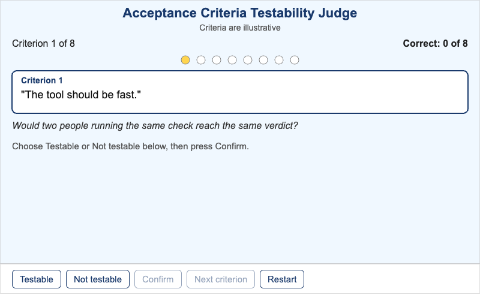

    The learner will assess whether each of 8 acceptance criteria is testable, by deciding if two people running the same check would reach the same verdict, with at least 7 correct.

-   **[AI Coding Agent Loop Stepper](./ai-coding-agent-loop-stepper/index.md)**

    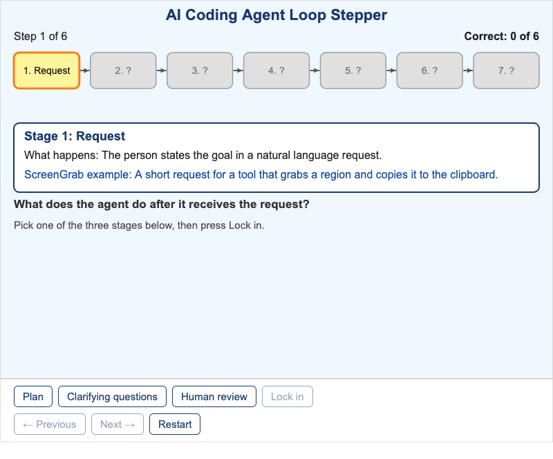

    The learner will explain the order of the seven stages an AI coding agent moves through, by predicting the next stage correctly in at least 5 of 6 steps.

-   **[AI-Assisted Build Stage Sequencer](./ai-assisted-build-stage-sequencer/index.md)**

    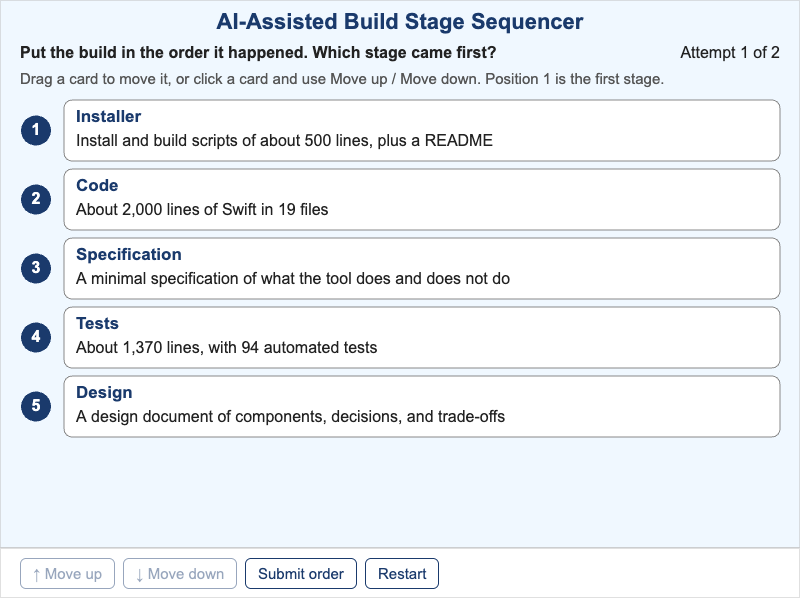

    The learner will list the five stages of the ScreenGrab build in their correct order, given five unordered cards that each show a stage and its output, within two attempts.

-   **[Break-Even Chart for a Generated Tool](./tco-break-even-chart/index.md)**

    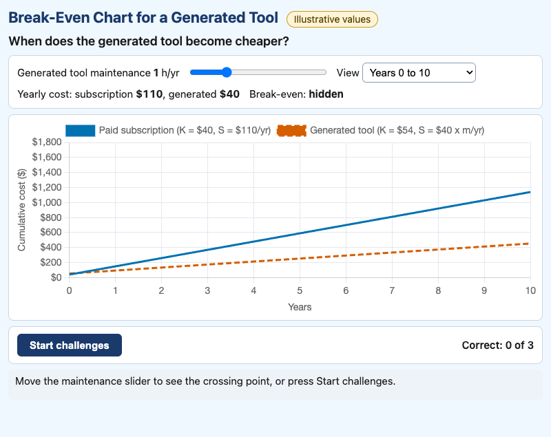

    The learner will calculate the break-even time between a paid subscription and a generated tool, to within 0.1 year, for 3 values of the generated tool's yearly maintenance time.

-   **[Bug Investigation Workflow](./bug-investigation-workflow/index.md)**

    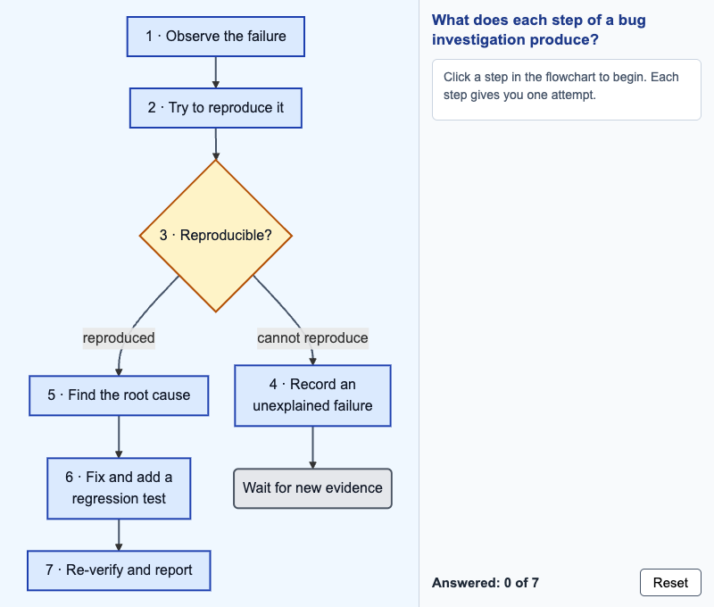

    The learner will identify what each of the seven steps of a bug investigation produces, answering at least 6 of 7 correctly.

-   **[Buy, Subscribe, or Generate Decision Explorer](./buy-subscribe-generate-decision-explorer/index.md)**

    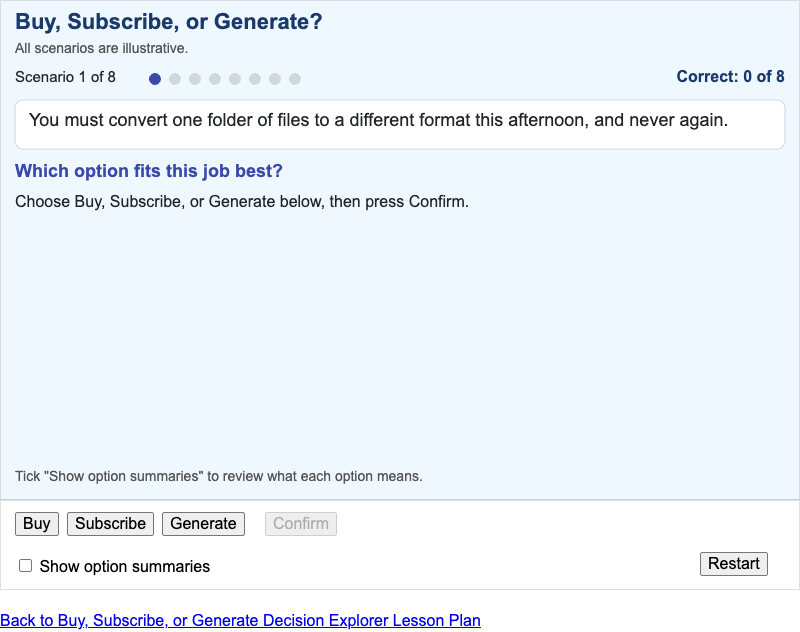

    The learner will recommend buy, subscribe, or generate for each of 8 scenarios, justified by how long the tool will be used and who supports it, with at least 6 correct.

-   **[Claim and Evidence Checker](./agent-claim-evidence-checker/index.md)**

    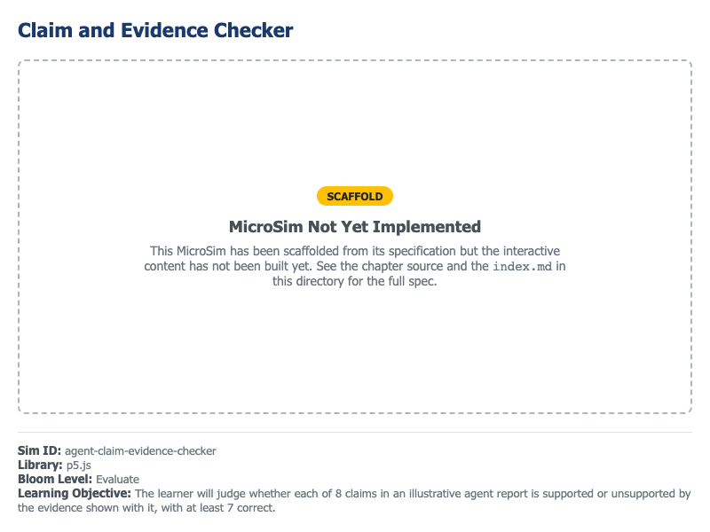

    The learner will judge whether each of 8 claims in an illustrative agent report is supported or unsupported by the evidence shown with it, with at least 7 correct.

-   **[Design Trade-Off Judge](./design-trade-off-judge/index.md)**

    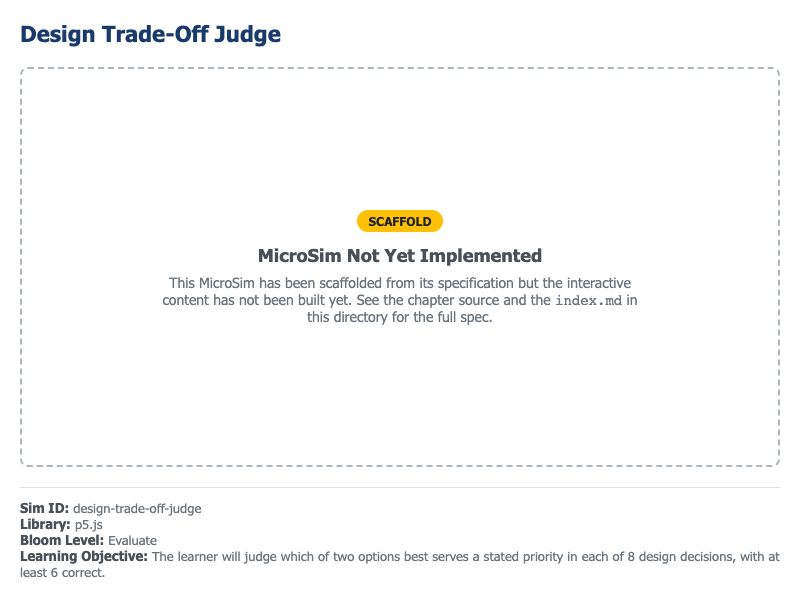

    The learner will judge which of two options best serves a stated priority in each of 8 design decisions, with at least 6 correct.

-   **[Feature Count Causal Loop Diagram](./feature-count-causal-loop/index.md)**

    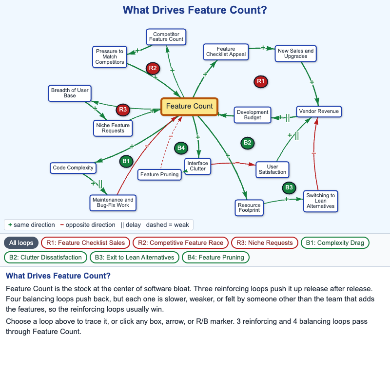

    The learner will analyze the causal loop diagram of software bloat by tracing each reinforcing and balancing loop through Feature Count and explaining, from the edge polarities, why each loop amplifies or limits feature growth.

-   **[Feature Growth and Usage Explorer](./bloat-feature-growth-explorer/index.md)**

    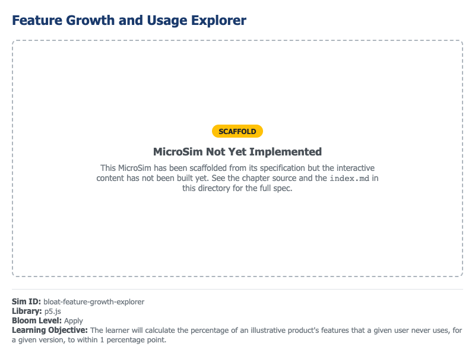

    The learner will calculate the percentage of an illustrative product's features that a given user never uses, for a given version, to within 1 percentage point.

-   **[Fork and Pull Request Flow](./fork-and-pull-request-flow/index.md)**

    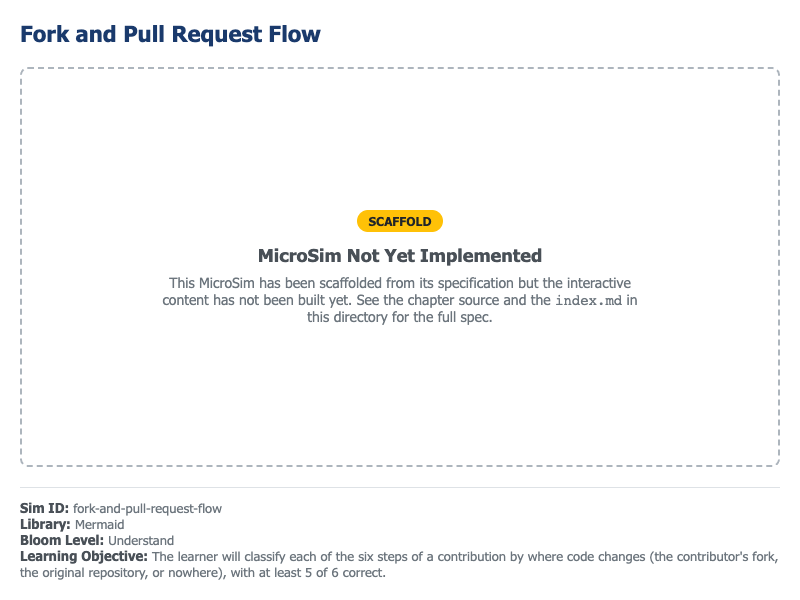

    The learner will classify each of the six steps of a contribution by where code changes (the contributor's fork, the original repository, or nowhere), with at least 5 of 6 correct.

-   **[License Offer Sorter](./licenses-offer-sorter/index.md)**

    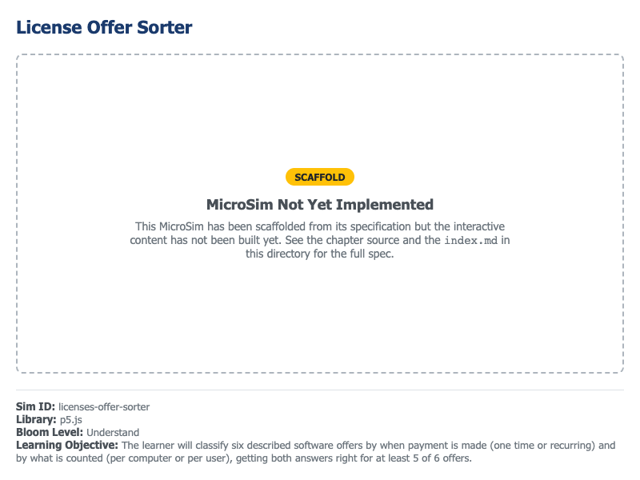

    The learner will classify six described software offers by when payment is made (one time or recurring) and by what is counted (per computer or per user), getting both answers right for at least 5 of 6 offers.

-   **[Long Tail of Feature Usage Explorer](./usage-long-tail-explorer/index.md)**

    

    The learner will examine an illustrative 20-feature usage distribution and state how many features are used by at least a chosen share of users, correctly for 3 of 3 thresholds.

-   **[Open Source License Matcher](./open-source-license-matcher/index.md)**

    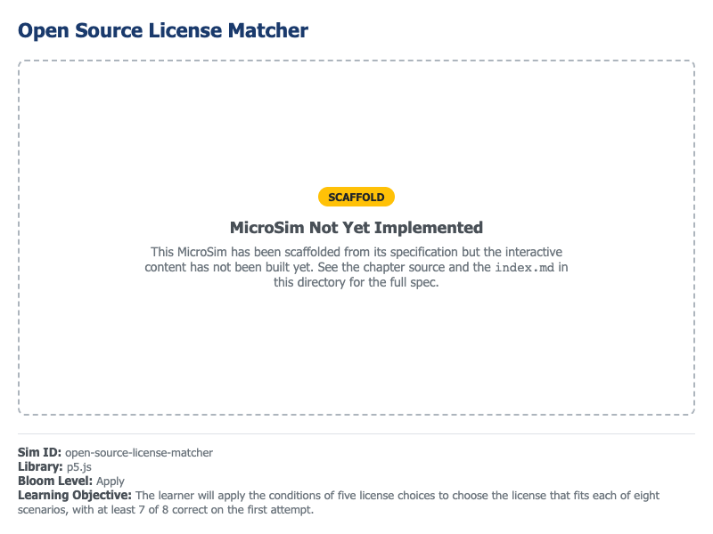

    The learner will apply the conditions of five license choices to choose the license that fits each of eight scenarios, with at least 7 of 8 correct on the first attempt.

-   **[Prompt Cache Cost Calculator](./prompt-cache-cost-calculator/index.md)**

    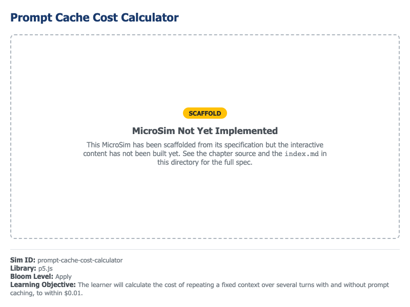

    The learner will calculate the cost of repeating a fixed context over several turns with and without prompt caching, to within $0.01.

-   **[Requirement Type Sorter](./requirement-type-sorter/index.md)**

    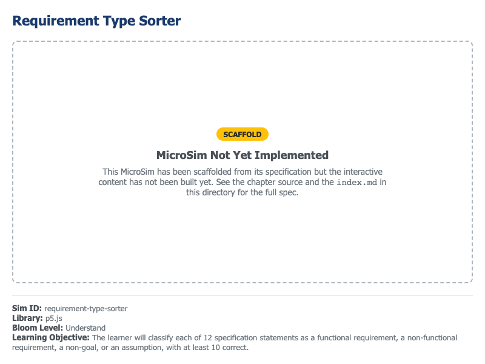

    The learner will classify each of 12 specification statements as a functional requirement, a non-functional requirement, a non-goal, or an assumption, with at least 10 correct.

-   **[Resource Footprint Comparison](./bloat-footprint-comparison/index.md)**

    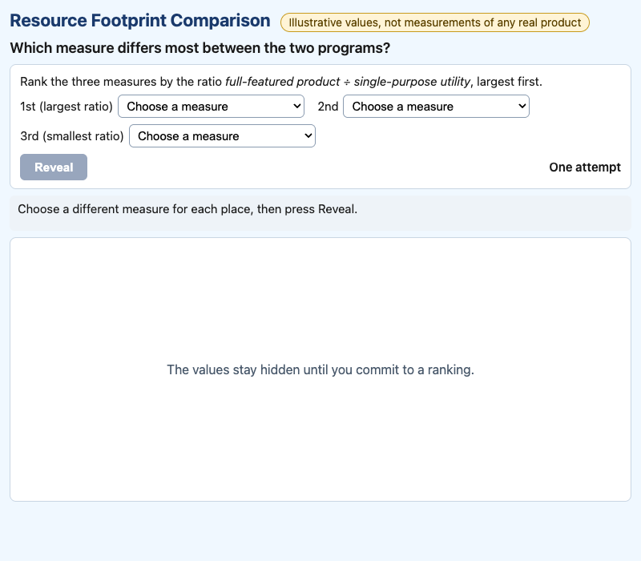

    The learner will compare the resource footprint of an illustrative full-featured product and an illustrative single-purpose utility on three measures, correctly ranking which measure differs most between them.

-   **[ScreenGrab Component Map](./screengrab-component-map/index.md)**

    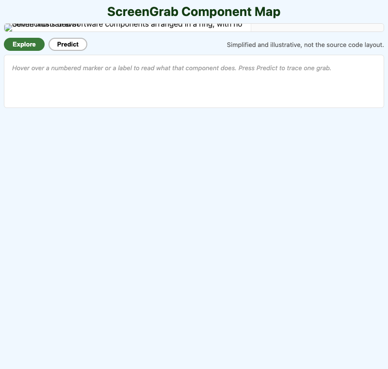

    The learner will explain the order in which seven components handle one immediate screen grab, by choosing the next component correctly in at least 5 of 6 steps.

-   **[ScreenGrab First Install Size Breakdown](./screengrab-first-install-size-breakdown/index.md)**

    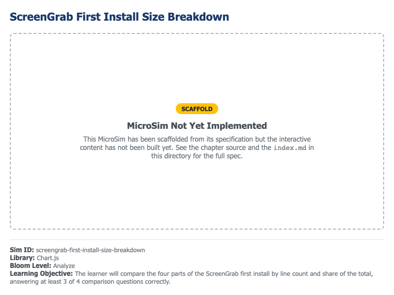

    The learner will compare the four parts of the ScreenGrab first install by line count and share of the total, answering at least 3 of 4 comparison questions correctly.

-   **[ScreenGrab Grab Flow Test Coverage](./grab-flow-test-coverage/index.md)**

    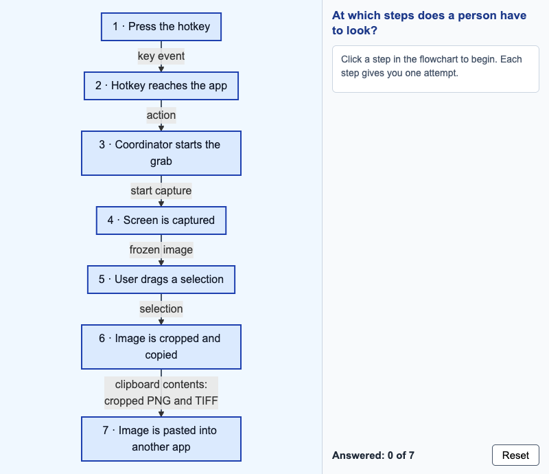

    The learner will distinguish the steps of a ScreenGrab grab that an automated test can confirm from the steps that only a person can confirm, by marking all 7 steps and matching the Content table on at least 6 of 7.

-   **[Session Cost Estimator](./session-cost-estimator/index.md)**

    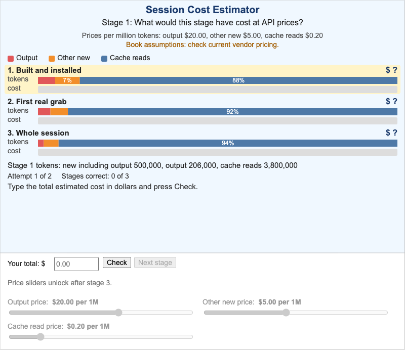

    The learner will calculate the estimated API cost of each of the three ScreenGrab session stages from its token counts and the stated prices, to within $0.02.

-   **[Software Vocabulary Concept Map](./bloat-software-concept-map/index.md)**

    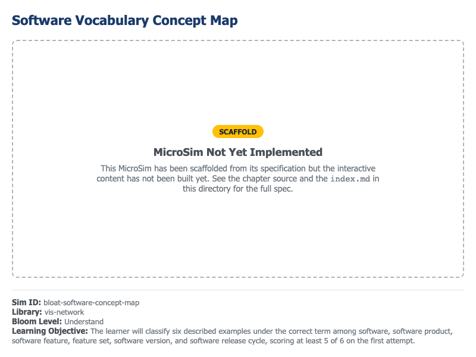

    The learner will classify six described examples under the correct term among software, software product, software feature, feature set, software version, and software release cycle, scoring at least 5 of 6 on the first attempt.

-   **[Subscribe or Generate Cost Calculator](./subscribe-or-generate-cost-calculator/index.md)**

    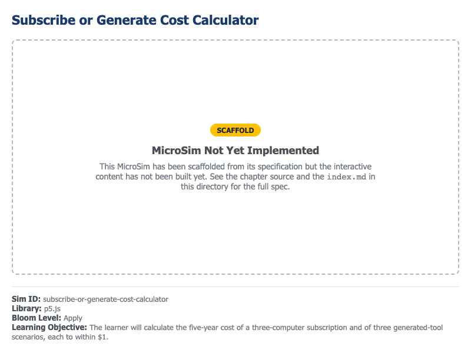

    The learner will calculate the five-year cost of a three-computer subscription and of three generated-tool scenarios, each to within $1.

-   **[Switching Cost Calculator](./licenses-switching-cost-calculator/index.md)**

    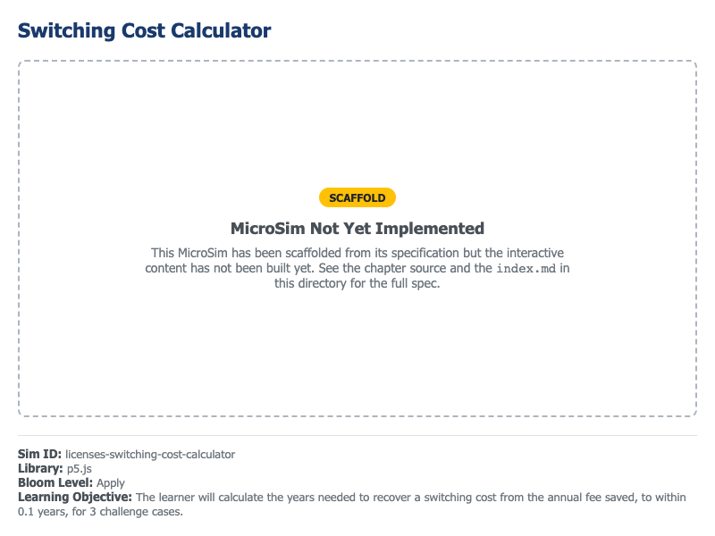

    The learner will calculate the years needed to recover a switching cost from the annual fee saved, to within 0.1 years, for 3 challenge cases.

-   **[Token Share Versus Cost Share Chart](./token-share-versus-cost-share/index.md)**

    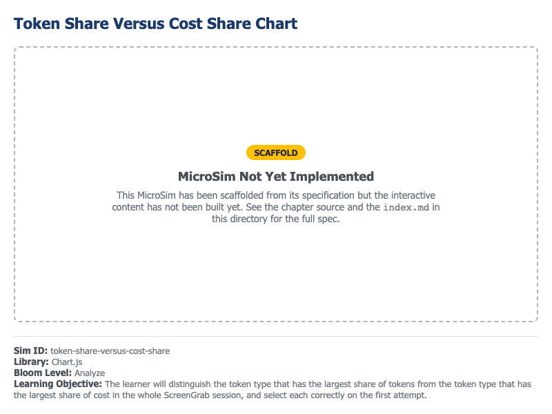

    The learner will distinguish the token type that has the largest share of tokens from the token type that has the largest share of cost in the whole ScreenGrab session, and select each correctly on the first attempt.

-   **[Token Split Explorer](./token-split-explorer/index.md)**

    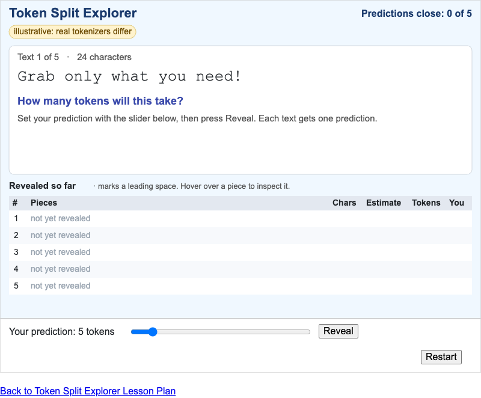

    The learner will compare their predicted token count with the illustrative split for each of five short texts, and identify the one text that the four-characters-per-token rule underestimates by more than 50%.

-   **[Total Cost of Ownership Calculator](./tco-calculator/index.md)**

    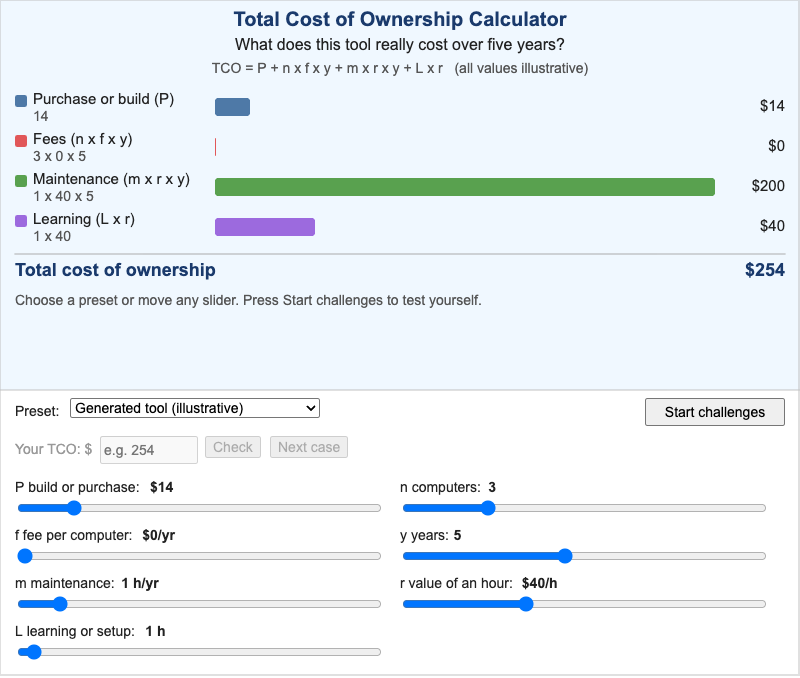

    The learner will calculate the total cost of ownership of a software path over a chosen number of years, to within $1, for 3 challenge cases.

-   **[Vendor Incentive Explorer](./licenses-vendor-incentive-explorer/index.md)**

    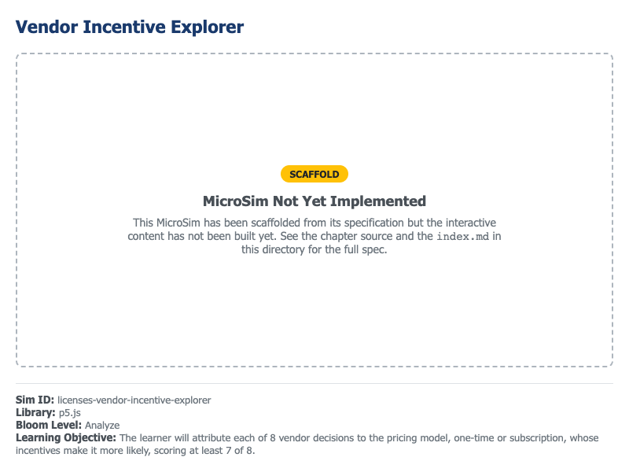

    The learner will attribute each of 8 vendor decisions to the pricing model, one-time or subscription, whose incentives make it more likely, scoring at least 7 of 8.

-   **[Verification Status Classifier](./verification-status-classifier/index.md)**

    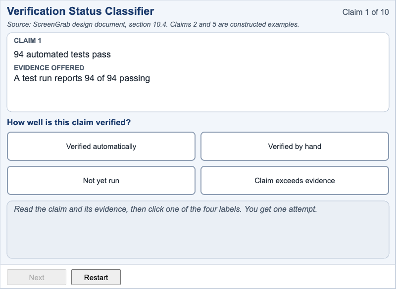

    The learner will judge the verification status of each of ten ScreenGrab claims from the evidence offered for it, with at least 8 of 10 correct on the first attempt.

-   **[Weighted Decision Matrix Explorer](./weighted-decision-matrix-explorer/index.md)**

    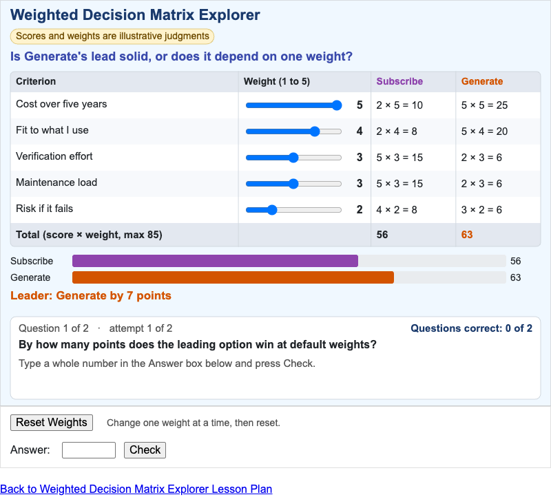

    The learner will judge how robust the winner of a weighted decision matrix is by finding which single-criterion weight changes flip the winner, answering both evaluation questions correctly.

-   **[Which Test Can Confirm This](./which-test-can-confirm-this/index.md)**

    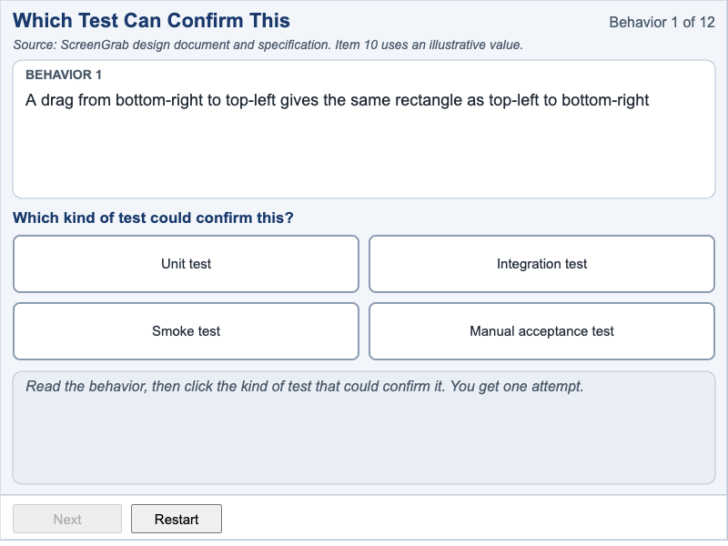

    The learner will classify each of twelve ScreenGrab behaviors as confirmable by a unit test, an integration test, a smoke test, or a manual acceptance test, with at least 10 of 12 correct on the first attempt.

-   **[Why Features Get Added Sorter](./usage-feature-driver-sorter/index.md)**

    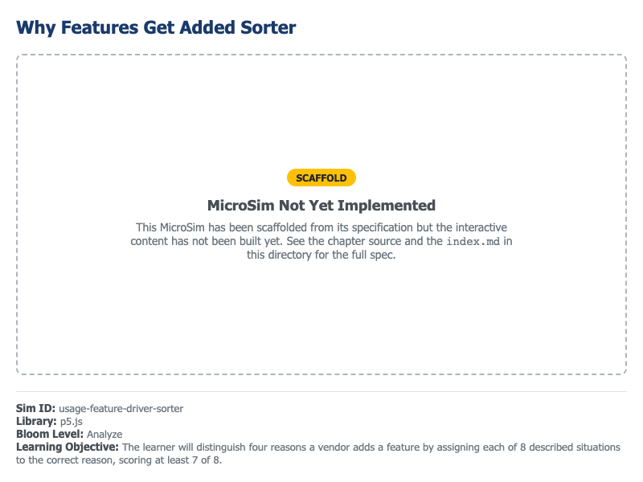

    The learner will distinguish four reasons a vendor adds a feature by assigning each of 8 described situations to the correct reason, scoring at least 7 of 8.

